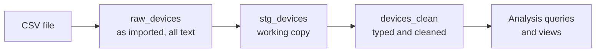

# Medical Device Failure Analysis (PostgreSQL)

A SQL-based data analysis project using PostgreSQL and pgAdmin 4 to investigate the reliability, maintenance costs and downtime of 4,149 medical devices from a simulated, anonymized dataset.

The project follows an end-to-end workflow, from data import and profiling to data cleaning, quality checks and analytical querying. The analysis is approached from the perspective of a hospital biomedical engineering team: which devices fail most, how maintenance costs and downtime vary across equipment, and which devices may require further review.


## Learning Highlights

| Area | Techniques |
|---|---|
| Data import | CSV import into a text-only staging table |
| Data profiling | Missing values, duplicates, invalid values, outliers (IQR) |
| Data cleaning | Type conversion, text standardisation, extracting fields from free text |
| Data integrity | CHECK constraints, indexes, audit log of cleaning steps |
| Querying | GROUP BY, HAVING, FILTER, CASE |
| Advanced SQL | CTEs, window functions (RANK, LAG, running totals), CORR |
| Reporting | Reusable views |

## Project Structure

```
medical-device-failure-sql/
├── README.md
├── data/
│   └── Medical_Device_Failure_dataset.csv
└── sql/
    ├── 01_create_raw_table.sql
    ├── 02_data_profiling.sql
    ├── 03_data_cleaning.sql
    └── 04_analysis_queries.sql
```

All tables and views are created in a PostgreSQL database named `medical_equipment_db`:

```
medical_equipment_db
└── public
    ├── Tables
    │   ├── raw_devices
    │   ├── stg_devices
    │   ├── devices_clean
    │   └── cleaning_log
    └── Views
        ├── v_device_type_kpis
        └── v_high_risk_devices
```

The data moves through three stages:



`raw_devices` is never modified, so the whole pipeline can be rerun at any time. Every cleaning step records how many rows it changed in `cleaning_log`.

## Dataset Description

**Source:** [Medical Device Failure Dataset (Anonymized)](https://www.kaggle.com/datasets/antoinepierreno/medical-device-failure-dataset-anonymized) on Kaggle, CC0 license
**Size:** 4,149 devices, 13 columns
**Coverage:** CT, MRI and PET scanners, X-ray machines, defibrillators and infusion pumps from six manufacturers in six countries

The dataset is simulated. According to its author, it was built from patterns seen in anonymised hospital maintenance records, clinical engineering reports and simulated incident logs, with inspiration from sources such as the FDA's MAUDE database. This is visible in the data: the values are unusually balanced, with exactly 1,383 devices in each maintenance class.


| Column | Description |
|---|---|
| Device_ID | Unique device identifier (e.g. MD03449) |
| Device_Type | Category of medical device |
| Purchase_Date | Date of purchase (2013 to 2024) |
| Age | Age of the device in years |
| Manufacturer | Company that produced the device |
| Model | Model name |
| Country | Country in which the device is operated |
| Maintenance_Cost | Cost of maintenance |
| Downtime | Hours the device was out of service |
| Maintenance_Frequency | Number of maintenance visits (1 to 5) |
| Failure_Event_Count | Number of recorded failures (0 to 10) |
| Maintenance_Class | Maintenance classification (1, 2 or 3) |
| Maintenance_Report | Free-text note written by the technician |


## How to Run This Project

| Step | Action |
|---|---|
| 1. Create the database | In pgAdmin, create a database named `medical_equipment_db` and open the Query Tool |
| 2. Create the raw table | Run `sql/01_create_raw_table.sql` |
| 3. Import the CSV | Right-click `raw_devices` → **Import/Export Data** → select `data/Medical_Device_Failure_dataset.csv`, format **csv**, **Header** on |
| 4. Check the import | `SELECT COUNT(*) FROM raw_devices;` should return **4149** |
| 5. Profile | Run the queries in `sql/02_data_profiling.sql` one at a time |
| 6. Clean | Run `sql/03_data_cleaning.sql` as a single script |
| 7. Analyse | Run the queries in `sql/04_analysis_queries.sql` one at a time |

> **Note:** All columns are imported as text so that unexpected values cannot interrupt the import. If the count returns 4150, the header row was imported as data: run `TRUNCATE raw_devices;` and import again with **Header** on.

## Data Profiling

At first glance the dataset looks clean: no missing values, no duplicate devices and consistent category names. A closer inspection revealed the following issues:

| Issue | Rows affected |
|---|---:|
| Negative maintenance costs | 105 |
| Costs and downtime with excessive decimals (e.g. 7115.349585060145) | all |
| Repeated words in technician notes ("Component component upgrade") | 141 |
| Technician notes starting with a lowercase letter | 1,048 |
| Issue type and corrective action buried in free text | all |
| Unusually high maintenance costs (IQR method) | ~90 |

All six manufacturers also share the same model names, so a model name alone does not identify a product. Device age was checked against purchase date and was consistent for every row.

## Data Cleaning

| Problem | Solution |
|---|---|
| Extra spaces and blank values | Trimmed; blanks converted to NULL |
| Everything stored as text | Converted to DATE, NUMERIC and INTEGER; money and hours rounded to 2 decimals |
| 105 negative costs | Set to NULL and flagged in a `dq_issue` column instead of deleted |
| Messy technician notes | Repeated words removed, first letter capitalised |
| Information hidden in notes | Extracted into `issue_type`, `action_taken` and `report_category` |
| Maintenance class shown as 1, 2, 3 | Added `severity_level` (Low, Medium, High) |
| Extreme costs and downtime | Flagged as outliers so they can be excluded when needed |
| Risk of future bad data | CHECK constraints and indexes added |

> `INITCAP()` was first used to standardise device names, but it changed "CT Scanner" to "Ct Scanner". The names were already consistent, so the step was removed to prevent new errors it might introduce.

## Analysis

The 16 questions follow the needs of a biomedical engineering manager, moving from a general overview to specific actions.

| # | Question | SQL used |
|---:|---|---|
| | **Overview** | |
| 1 | Total devices, failures, maintenance cost and downtime | Aggregates, FILTER |
| 2 | Device types per country | GROUP BY |
| | **Device reliability** | |
| 3 | Which device types fail most? | GROUP BY, AVG |
| 4 | Manufacturer reliability ranking | RANK |
| 5 | Best and worst manufacturer for each device type | CTE, RANK with PARTITION BY |
| 6 | Most frequently reported technical issues | Window percentage of total |
| 7 | Are issues concentrated in certain device types? | Pivot with FILTER |
| | **Failure drivers** | |
| 8 | Do older devices fail more often? | CASE age groups |
| 9 | Does more maintenance mean fewer failures? | GROUP BY |
| 10 | How strong are these relationships? | CORR |
| | **Cost and downtime** | |
| 11 | Average cost and downtime per severity level | GROUP BY |
| 12 | Most expensive device types and cost per failure | Window percentage of total |
| 13 | Corrective actions with the longest downtime and highest cost | GROUP BY |
| 14 | Which combinations make up 80% of maintenance cost? | CTE, running total (Pareto) |
| | **Recommended actions** | |
| 15 | High-risk devices (≥ 2× type average failures and above-average downtime) | CTE, window AVG |
| 16 | Purchase-year cohorts with year-over-year change | CTE, LAG |

Two views, `v_device_type_kpis` and `v_high_risk_devices`, store key results for reuse in later queries or reporting.

## Write up your findings (Reports)

Interpret the results honestly. Examples of what you'll see:
- Severity drives cost: High-severity cases cost roughly 3× Low-severity ones and have ~3× the downtime.
- Differences between device types and manufacturers are **small** (avg failures 1.88–2.02).
  Best/worst per device type (Q5) shows bigger gaps.
- Age and maintenance frequency have almost **no correlation** with failures (Q10 ≈ 0).
  "No relationship" is a valid finding — say so rather than forcing a story.

## Limitations

Because the dataset is simulated, its values are evenly distributed and its relationships are weaker than in real hospital data, which explains why age and maintenance frequency show almost no effect on failures. The results should be read as a demonstration of the analytical method rather than as conclusions about real devices or manufacturers.
